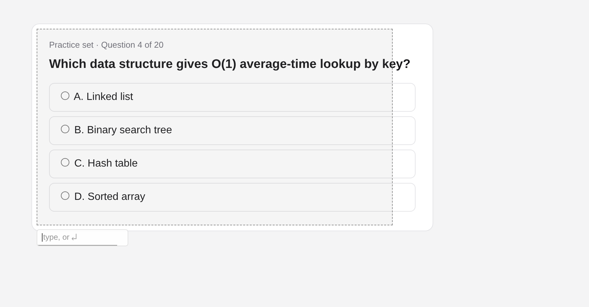
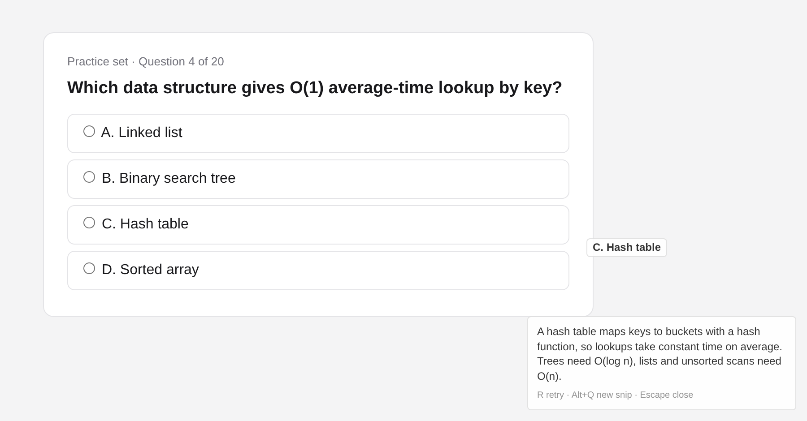

  

<h1 align="center">easyQuiz</h1>

  Snip a practice question, get the answer next to your cursor, and never leave the page. 
  A small, quiet browser extension for Chrome, Edge, Brave, Firefox and Zen, powered by Groq's free API.

  
  
  

<table>
  <tr>
    <td></td>
    <td></td>
  </tr>
  <tr>
    <td align="center">1. Press <kbd>Alt</kbd>+<kbd>Q</kbd> and drag around the question</td>
    <td align="center">2. The answer appears at your cursor</td>
  </tr>
</table>

## Features

- **One shortcut, one drag, Enter.** No new tabs and no copy-paste.
- **Answer at your cursor.** Longer explanations go in a small panel in the corner.
- **Page locked while open.** Your keys and clicks can't change the page by accident. <kbd>Esc</kbd> gives it back.
- **Minimal look.** Small, light/dark aware, with adjustable opacity.
- **Free.** Uses your own Groq key, and stays inside the free-tier limits by itself.
- **Private.** No server, no analytics. See [PRIVACY.md](PRIVACY.md).

## Install

Download the latest files from **[Releases](https://github.com/Sanjay-Sunil/easyQuiz/releases/latest)**, or clone this repo.

<b>Chrome, Edge, Brave, Opera, Vivaldi, Arc</b>

1. Unzip `easyquiz-chromium.zip`, or use the cloned folder.
2. Open `chrome://extensions` (or `edge://extensions`, `brave://extensions`, …).
3. Turn on **Developer mode**, click **Load unpacked**, and select the folder.

<b>Zen, LibreWolf, Floorp, Firefox Developer/Nightly</b>

1. Open `about:config` and set `xpinstall.signatures.required` to `false`.
2. Open `about:addons`, click ⚙ → **Install Add-on From File…**, and choose `easyquiz-firefox.xpi`.

<b>Firefox (release)</b>

Release Firefox only installs signed add-ons. To try it without signing, open `about:debugging#/runtime/this-firefox` → **Load Temporary Add-on…** and pick `manifest.json`. It's removed when Firefox restarts.
To keep it installed, sign your own copy for free: `npx web-ext sign --channel=unlisted` with API keys from addons.mozilla.org → Developer Hub.

**Then:** the setup page opens. Paste a free key from [console.groq.com/keys](https://console.groq.com/keys), click **Test**, and **Save**.
If you see **Allow access to websites**, click it. Firefox-based browsers sometimes leave site access off at install.

## Use

| | Default key |
| --- | --- |
| Start a snip | <kbd>Alt</kbd>+<kbd>Q</kbd>, or click the toolbar icon |
| Select the question | drag |
| Send (optional typed note first) | <kbd>Enter</kbd>, or wait 3 s to send the default prompt |
| Retry | <kbd>R</kbd> |
| New snip | <kbd>Alt</kbd>+<kbd>Q</kbd> |
| Close and use the page again | <kbd>Esc</kbd> |

You can change any key on the setup page. A backup shortcut (<kbd>Alt</kbd>+<kbd>Shift</kbd>+<kbd>Q</kbd>) is handled by the browser itself, so it works even when the page has captured the keyboard.

## Free-tier limits

The default model is `qwen/qwen3.8-27b`, currently Groq's vision model. Its free tier allows **30 requests/min, 1,000/day and 8K tokens/min**, and each image counts as 2,048 tokens.
easyQuiz reads Groq's rate-limit headers after every call. When you're close to the limit it waits on its own (`wait 4s` shows at the cursor). When the daily limit runs out, it tells you instead of failing. To fit more snips into each minute, set **Reasoning** to *None* on the setup page.

## Limitations

- Browsers don't let extensions run on their own pages (`chrome://`, `about:`), extension stores or the built-in PDF viewer.
- Paste and non-English keyboard input (IME) don't work in the prompt box, because keys are read directly so the page never sees them.
- Safari isn't supported.

## Contributing

Issues and pull requests are welcome. See [CONTRIBUTING.md](CONTRIBUTING.md) for setup, tests and the code map. For security problems, see [SECURITY.md](SECURITY.md).

## License

[MIT](LICENSE) © Sanjay S
